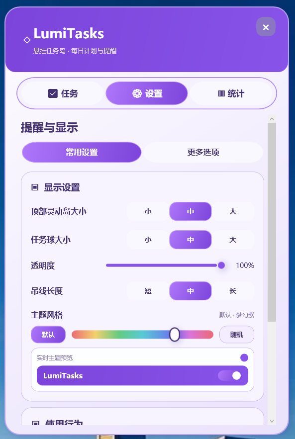

# LumiTasks

**LumiTasks** 是一款适用于 Windows 的桌面任务管理工具，采用悬浮“灵动岛”主栏与任务球来展示日常任务、提醒和计时。

## 📥 下载 LumiTasks

**最新版本：v4.2.5**

支持 Windows 10 / 11（64 位）。

[⬇ 下载 Windows 正式版](https://github.com/ManDaBai/LumiTasks/releases/latest)

下载 ZIP 压缩包，解压后双击 `LumiTasks.exe` 即可运行，无需安装。

## 🖼️ 软件预览

### 桌面灵动岛与任务球


### 任务管理与设置



## 功能


- 桌面悬浮灵动岛与任务球，可展开或收起任务展示
- 创建任务、标记完成、任务分类与自定义分类管理
- 任务计时和提醒、系统托盘入口
- `Ctrl + Alt + L` 全局快捷键隐藏或恢复灵动岛
- 灵动岛主栏“小／中／大”三级尺寸设置
- 主题外观及任务球显示选项
- Windows 登录时自动启动选项
- 本地 JSON 数据保存及备份／导入功能

## 系统要求

- **Windows 10 / Windows 11，64 位**（尚未对其他平台提供支持）
- 从源码构建：**.NET 8 SDK**

## 从源码构建

1. 安装 [.NET 8 SDK](https://dotnet.microsoft.com/download/dotnet/8.0)。
2. 下载或克隆本仓库。
3. 在 Windows 上双击 `Build-Windows-x64.cmd`，或使用 PowerShell 运行 `Build-Windows-x64.ps1`。
4. 成功后在 `publish` 目录查找生成的 `LumiTasks.exe`。

如果希望自己手动编译：

```powershell
dotnet restore .\src\LumiTasks.csproj -r win-x64
dotnet publish .\src\LumiTasks.csproj -c Release -r win-x64 --self-contained true -p:PublishSingleFile=true -p:IncludeNativeLibrariesForSelfExtract=true -p:DebugType=None -p:DebugSymbols=false -o .\publish
```

> 本工程的构建脚本只输出到源码所在目录的 `publish`，不会主动升级已安装的程序。

## 使用说明

- 点击灵动岛的 **+** 新建任务。
- 点击展开按钮显示或收起任务球。
- 使用 **Ctrl + Alt + L** 隐藏或恢复灵动岛。
- 在设置中调整顶部灵动岛的大小与外观。
- 程序将任务保存在当前 Windows 用户的 `%LOCALAPPDATA%\LumiTasksWPFPreview` 路径中，请妥善备份。


## 🛡️ 开源许可证

LumiTasks 基于 MIT License 开源。

详细信息请查看 [LICENSE](LICENSE) 文件。

## 💬 问题反馈与功能建议

欢迎使用者反馈问题或提出建议。

- [提交 Bug 或运行问题](https://github.com/ManDaBai/LumiTasks/issues/new?template=bug_report.md)
- [提出新功能建议](https://github.com/ManDaBai/LumiTasks/issues/new?template=feature_request.md)

反馈时请尽量说明系统版本、LumiTasks 版本、问题发生步骤，并附上相关截图。

请勿公开个人任务数据或敏感信息。


---
